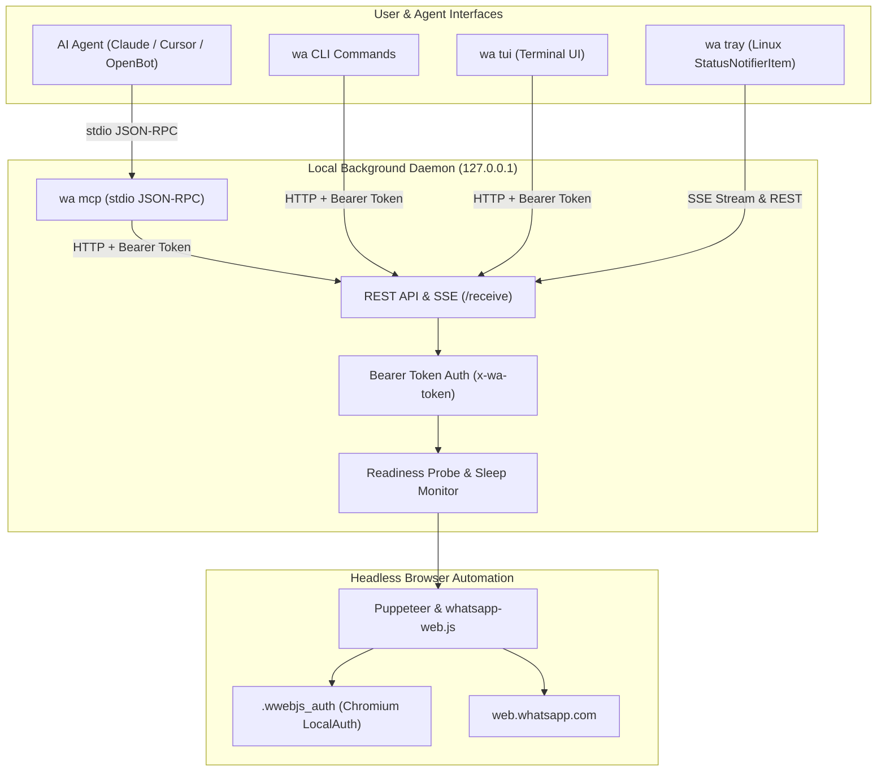

# 💬 wa — WhatsApp CLI & MCP Server

[](./LICENSE)
[](https://nodejs.org/)
[](https://modelcontextprotocol.io/)
[](./docs/cross-platform.md)
[](./test/)

A robust, scriptable WhatsApp automation suite for the terminal and AI agents:
- **Fast CLI & TUI:** Lightweight frontend command line and zero-dependency ANSI dashboard (`wa tui`).
- **Background Daemon:** Long-lived HTTP service (`127.0.0.1`) backed by Puppeteer and [`whatsapp-web.js`](https://github.com/pedroslopez/whatsapp-web.js).
- **Model Context Protocol (MCP) Server:** Built-in stdio server exposing 9 tools for AI agents (OpenBot, Claude, Cursor, Copilot, Antigravity).
- **Portable Agent Skill:** Turnkey skill package in [`skills/whatsapp/`](./skills/whatsapp/) with schemas, workflows, and parameter bounds.
- **Media Support:** Send photos/images (up to 16 MB) with captions and documents/files (up to 100 MB) with original filenames.
- **Linux Tray Manager & Sleep Recovery:** Native StatusNotifierItem system-tray indicator with automated laptop sleep/wake recovery.
- **Cross-Platform:** Full support for Linux, macOS, and Windows 10/11.

---

## Architecture

```
┌─────────────────┐      ┌─────────────────────────┐
│  AI Agent (MCP) │      │  wa CLI / wa tui (ANSI) │
└────────┬────────┘      └────────────┬────────────┘
         │ stdio                      │ loopback HTTP (x-wa-token)
         ▼                            ▼
┌──────────────────────────────────────────────────┐
│           WhatsApp Background Daemon             │
│   Token Auth  •  Readiness Probe  •  Event Bus   │
└────────────────────────┬─────────────────────────┘
                         │ Puppeteer CDP
                         ▼
┌──────────────────────────────────────────────────┐
│       Chromium Headless (WhatsApp Web)           │
│   LocalAuth (.wwebjs_auth)  •  Websocket Sync    │
└──────────────────────────────────────────────────┘
```



---

## Platform Support Matrix

| Feature | Linux | macOS | Windows 10 / 11 |
| :--- | :---: | :---: | :---: |
| **CLI Commands (`wa send`, `wa chats`, etc.)** | Full | Full | Full (PowerShell / CMD) |
| **Interactive Terminal UI (`wa tui`)** | Full | Full | Full (Windows Terminal) |
| **Background Daemon (`wa daemon`)** | Full | Full | Full |
| **Model Context Protocol Server (`wa mcp`)** | Full | Full | Full |
| **Photo & Document Sending** | Full | Full | Full |
| **StatusNotifierItem Tray Manager (`wa tray`)** | Full | N/A (Linux-only) | N/A (Linux-only) |
| **Suspend/Resume DBus Recovery** | Full | Fallback Heartbeat | Fallback Heartbeat |
| **Autostart Service** | Systemd User Unit | launchd plist | Task Scheduler |

For detailed operating system prerequisites and installation instructions, see the [Cross-Platform Guide](./docs/cross-platform.md).

---

## Quick Start (3 Minutes)

### 1. Requirements
- Node.js >= 18.0.0
- Git
- A mobile phone with WhatsApp installed

### 2. Install
```bash
git clone https://github.com/hanzlaahmadcheema/whatsapp-cli.git
cd whatsapp-cli

# Install dependencies (automatically applies compatibility patch)
npm install

# Expose 'wa' globally
npm link
```

### 3. Link Your WhatsApp Account
```bash
wa login
```
Scan the terminal QR code in WhatsApp (**Settings** > **Linked Devices** > **Link a device**). The session persists locally in `.wwebjs_auth/` — you only need to scan once.

### 4. Basic Usage
```bash
wa status                                    # verify connection and daemon state
wa chats                                     # list recent conversations
wa send 15551234567 "Hello from WhatsApp CLI" # send a message
wa send-image 15551234567 photo.jpg "Caption" # send a photo
wa send-file 15551234567 document.pdf         # send a document
wa tui                                       # launch interactive terminal UI
```

---

## CLI Command Reference

| Command | Description |
| :--- | :--- |
| `wa login` | Display QR code to link device; skips if already authenticated |
| `wa status` | Show daemon state (`ready`, `linking`, `recovering`), linked account, port, and PID |
| `wa chats [--limit N]` | List recent conversations with unread badges and snippets |
| `wa contacts [--name ...]` | Search address book contacts, optionally filtered by name |
| `wa history <contact> [--limit N]` | Show message history for a contact or group |
| `wa chat <contact>` | Stream incoming and outgoing messages live for a contact |
| `wa send <contact\|group> <message>` | Send a plain text message (multiple words join automatically) |
| `wa send-image <contact> <file> [caption]` | Send an image/photo (JPEG, PNG, WebP, GIF, SVG) up to 16 MB with optional caption |
| `wa send-file <contact> <file> [caption]` | Send a document/binary file up to 100 MB with original filename |
| `wa receive [--once]` | Stream all incoming messages live via Server-Sent Events (SSE) |
| `wa tui` | Open full-screen ANSI interactive terminal dashboard |
| `wa mcp` | Launch Model Context Protocol stdio server for AI agents |
| `wa tray [--foreground]` | Start native Linux StatusNotifierItem system-tray manager |
| `wa reconnect` | Trigger a controlled session recovery and browser re-probe |
| `wa autostart [enable\|disable\|status]` | Manage systemd user services for background startup on login |
| `wa stop` | Gracefully shut down the running background daemon |
| `wa restart` | Restart the background daemon process |
| `wa logout` | Force logout and unlink local session credentials |

---

## Model Context Protocol (MCP) Server

`wa` includes a built-in MCP stdio server conforming to the [Model Context Protocol](https://modelcontextprotocol.io/) specification.

Launch the server with:
```bash
wa mcp
# Or directly via Node.js:
node src/mcp/index.js
```

### 9 Exposed MCP Tools

| Tool | Action | Parameters | Description |
| :--- | :--- | :--- | :--- |
| `whatsapp_get_status` | Inspect Status | None | Check daemon health, connection state (`ready`, `linking`, `recovering`), and authenticated phone number. |
| `whatsapp_list_chats` | List Chats | `limit` (default: 50) | Retrieve recent conversations sorted by latest activity with unread counts. |
| `whatsapp_list_contacts` | Search Contacts | `name` (optional) | Query address book contacts by display name. |
| `whatsapp_get_chat_history` | Read History | `target`, `limit` (default: 50) | Fetch past messages for a contact, group JID, or `'me'`. |
| `whatsapp_send_message` | Send Text | `target`, `message` | Send plain text message (up to 65,000 characters). |
| `whatsapp_send_image` | Send Photo | `target`, `filePath`, `caption` | Send an image file up to 16 MB with an optional caption. |
| `whatsapp_send_document` | Send Document | `target`, `filePath`, `filename`, `caption` | Send any document or binary file up to 100 MB with custom or original filename. |
| `whatsapp_mark_seen` | Mark Read | `target` | Mark all unread messages in a chat as seen. |
| `whatsapp_get_recent_messages` | Stream Buffer | `limit`, `sinceTimestamp`, `chatId` | Read incoming messages buffered in memory since a given timestamp. |

### Recipient Target Resolution
All message and history tools accept:
- `"me"` or `"self"`: Resolves to the authenticated user's own phone number.
- International numbers without `+` (e.g. `15551234567` or `923001234567`).
- Contact JIDs: `15551234567@c.us`.
- Group JIDs: `120363000000000000@g.us`.

For complete tool schemas, input constraints, and return formats, see [MCP Tools Reference](./skills/whatsapp/references/mcp-tools.md).

---

## Connecting AI Agents

### 🤖 Autonomous Setup Prompt for AI Agents

You can have your AI assistant (Cursor, Claude Code, OpenBot, Google Antigravity, Windsurf, Roo Code) configure this integration end-to-end. Copy and paste this prompt into your agent:

```text
Please set up the WhatsApp CLI and Model Context Protocol (MCP) server for our environment:
1. Clone https://github.com/hanzlaahmadcheema/whatsapp-cli.git if not already present.
2. In the repository directory, run `npm install` (which automatically runs the wwebjs patch) and `npm link` so `wa` is globally available.
3. Add the WhatsApp MCP server to our agent MCP configuration:
   - command: "wa" (or "node <path-to-whatsapp-cli>/src/mcp/index.js")
   - args: ["mcp"]
4. If this agent supports skills, copy `skills/whatsapp/` to our skills directory (or import `skills/whatsapp/SKILL.md` into workspace instructions).
5. Guide me to run `wa login` in a visible terminal so I can scan the QR code with WhatsApp on my phone.
6. Once I confirm linking, verify the connection safely by calling the `whatsapp_get_status` tool (confirm state is "ready"). Do NOT send any test messages.
7. Confirm that all 9 WhatsApp tools are registered and ready for use.
```

---

### Manual Configuration Snippets

### Claude Desktop (`claude_desktop_config.json`)
```json
{
  "mcpServers": {
    "whatsapp": {
      "command": "wa",
      "args": ["mcp"]
    }
  }
}
```

### Cursor (`.cursor/mcp.json`)
```json
{
  "mcpServers": {
    "whatsapp": {
      "command": "wa",
      "args": ["mcp"]
    }
  }
}
```

### OpenBot & Antigravity
```json
{
  "mcpServers": {
    "whatsapp": {
      "command": "wa",
      "args": ["mcp"]
    }
  }
}
```

For complete step-by-step setup guides, Windows path configurations, and instructions for **VS Code Copilot**, **Claude Code**, and **Codex**, see the [AI Agent Integration Guide](./docs/agent-integration.md).

---

## Reusable Agent Skill (`skills/whatsapp/`)

This repository includes a portable, self-contained Agent Skill under [`skills/whatsapp/`](./skills/whatsapp/):
- **`skill.json`**: Official agent manifest declaring capabilities, tool dependencies, and media limits.
- **`SKILL.md`**: Conversational guidance, pre-flight verification rules, and error recovery procedures.
- **`references/mcp-tools.md`**: Full parameter schemas and error codes.
- **`examples/tool-usage.md`**: Concrete agent interaction scenarios.

### Installing the Skill
- **Antigravity / Gemini CLI:**
  ```bash
  cp -r skills/whatsapp ~/.gemini/antigravity-cli/skills/
  ```
- **OpenBot:**
  ```bash
  cp -r skills/whatsapp ~/.openbot/skills/
  ```
- **Cursor / VS Code:**
  Reference [`skills/whatsapp/SKILL.md`](./skills/whatsapp/SKILL.md) in your `.cursorrules` or `.github/copilot-instructions.md`.

---

## Linux System Tray & Suspend/Resume Recovery

`wa` includes a native Linux system-tray indicator (`src/tray/manager.py`) using system `AyatanaAppIndicator3` / `Gtk 3.0` bindings (Wayland & X11 compatible, tested on Hyprland, Quickshell, Waybar, GNOME, KDE).

### Visual State Icons (`assets/tray/`)

| State | Appearance | Meaning |
| :--- | :--- | :--- |
| **Ready** | Green (`#25D366`) with checkmark badge | Connected, authenticated, and verified operational |
| **Connecting** | Blue (`#0288D1`) with syncing dots badge | Connecting to WhatsApp Web or syncing chats |
| **Recovering** | Amber (`#FF9800`) with circular sync badge | Reconnecting session after network drop or sleep |
| **Error** | Red (`#E53935`) with alert badge | Intervention required or recovery exhausted |
| **Offline** | Grey (`#757575`) with slash badge | Daemon stopped or unreachable |

### Automated Sleep / Wake Lifecycle
When a laptop suspends, network interfaces drop and background headless Chromium sessions often wedge into infinite reload loops.
- `wa` monitors systemd-logind's `PrepareForSleep` DBus signal via `src/daemon/sleep.js`.
- On sleep, active probes pause and the daemon enters a suspended state.
- On wake, the daemon polls network and DNS reachability for `web.whatsapp.com` with exponential backoff before initiating reconnection.
- Reconnection is verified via `isClientUsable()` before advertising readiness.

### Autostart Management
```bash
# Enable systemd user autostart for daemon and tray
wa autostart enable

# Check status
wa autostart status

# Disable autostart
wa autostart disable
```

---

## Development & Testing

All unit tests run offline with zero network requests or WhatsApp credentials:

```bash
# Run complete test suite (93 unit tests)
npm test

# Test specific module
node --test test/unit/media.test.js
node --test test/unit/mcp.test.js
node --test test/unit/sleep.test.js
```

### whatsapp-web.js Compatibility Patch
Recent WhatsApp Web builds minified internal message keys (`_serialized` to `$1`). `scripts/wwebjs-patch.js` applies an idempotent patch during `postinstall`. You can manually trigger or verify it anytime:
```bash
npm run patch
```

---

## Security & Privacy

WhatsApp CLI is strictly **local-first**:
- The background daemon listens only on `127.0.0.1`.
- Authentication tokens are generated randomly per boot with `0600` file permissions.
- Session credentials and messages are stored on your local disk in `.wwebjs_auth/` and are **never** transmitted to third-party servers.
- Media paths are strictly validated to prevent directory traversal and reject non-regular files.

For full security architecture and vulnerability reporting, see [SECURITY.md](./SECURITY.md).

---

## Contributing

Contributions are welcome! Please read [CONTRIBUTING.md](./CONTRIBUTING.md) for development setup, testing standards, and pull request guidelines.

---

## License

[ISC](./LICENSE) © 2026 Hanzla Ahmad Cheema.
