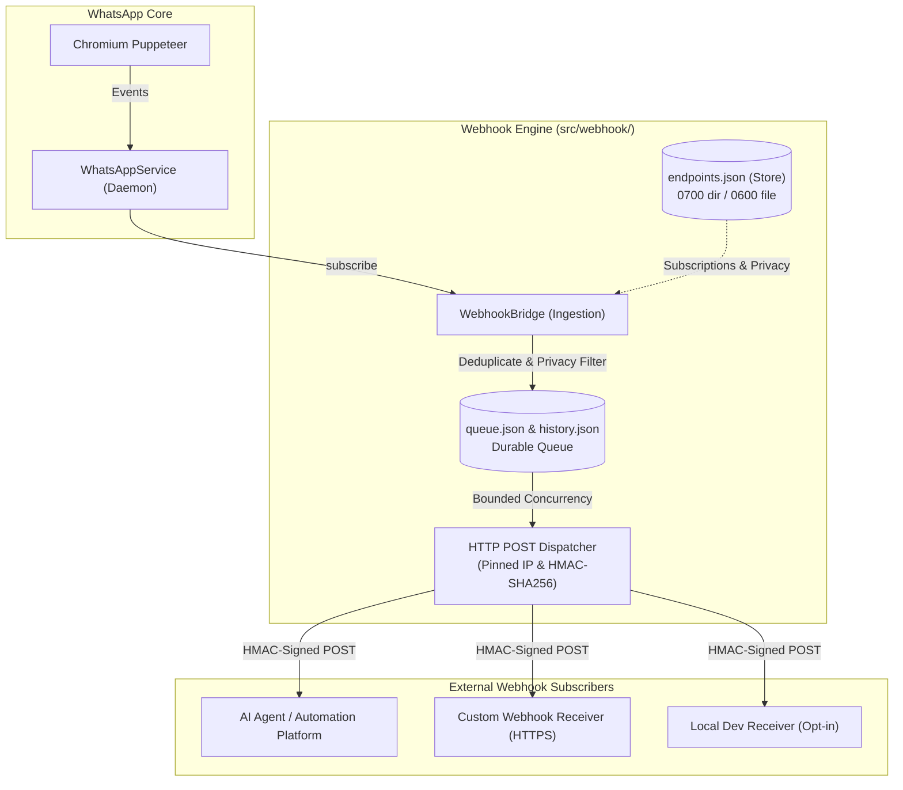

# Universal Webhook Engine Guide

A high-performance, durable, and platform-independent webhook notification system for the WhatsApp CLI and background daemon.

---

## 1. Architecture Overview

The Universal Webhook Engine dispatches real-time HTTP POST notifications whenever WhatsApp events occur (incoming messages, outbound messages, delivery receipts, message edits, media attachments, and session state transitions).

It operates completely out-of-band and asynchronously, ensuring that webhook dispatch never blocks WhatsApp message processing, Puppeteer events, or local SSE streams.



### Component Breakdown

1. **Ingestion & Event Bridge (`src/webhook/ingestion.js`)**:
   - Subscribes to `WhatsAppService`'s internal event broadcaster.
   - Normalizes raw WhatsApp messages and states into canonical catalog events (`message.received`, `message.sent`, `media.received`, `message.ack`, `message.updated`, `session.state`).
   - Deduplicates events using a bounded LRU cache to prevent re-dispatching during network reconnects.
   - Retrieves matching active endpoints and applies per-endpoint privacy filters.

2. **Endpoint Store (`src/webhook/store.js`)**:
   - Persists endpoint configurations to `.data/webhooks/endpoints.json`.
   - Restricts filesystem access using POSIX permissions (`0700` directory, `0600` file).
   - Generates cryptographically secure endpoint IDs (`wh_<hex>`) and HMAC secrets (`whsec_<hex>`).
   - Guarantees crash-safe persistence via temp-file creation, `fsyncSync`, and atomic rename.

3. **Persistent Delivery Queue (`src/webhook/queue.js`)**:
   - Disk-backed durable queue in `.data/webhooks/queue.json` with completed history in `history.json`.
   - **Crash Recovery**: Automatically scans on startup and recovers any deliveries stranded in `delivering` state back to `pending`.
   - **Isolation**: Serializes delivery per endpoint (`perEndpointConcurrency: 1`) to preserve FIFO ordering, while maintaining global bounded concurrency (`concurrency: 5`).
   - **Exponential Backoff**: Applies full uniform jitter to exponential delays on transient failures (HTTP 408, 429, 5xx, network resets).
   - **Dead-Letter Handling**: Permanently failed or exhausted deliveries transition to `dead_letter` for inspection and manual retry.

4. **Security & HTTP Dispatcher (`src/webhook/http.js` & `src/webhook/security.js`)**:
   - Validates destination URLs against SSRF rules (blocks loopback, cloud metadata `169.254.169.254`, private LANs, and carrier-grade NAT unless explicitly permitted).
   - **DNS Rebinding Defense**: Pre-resolves destination DNS and pins the physical socket connection to the validated IP via custom `lookup`.
   - Enforces HTTPS for remote destinations and disables HTTP redirects by default.
   - Signs request payloads with HMAC-SHA256 (`X-WA-Signature` and `X-Hub-Signature-256`).

---

## 2. Event Catalog

All outgoing webhook payloads follow a consistent, platform-independent JSON schema:

```json
{
  "id": "evt_rcv_false_1234567890@c.us_3EB0...",
  "event": "message.received",
  "timestamp": 1730441500,
  "account": {
    "number": "15551234567",
    "name": "My WhatsApp Account",
    "jid": "15551234567@c.us"
  },
  "data": { ... }
}
```

### Supported Events

| Event Type | Trigger | Key `data` Fields |
| :--- | :--- | :--- |
| `message.received` | Inbound message received from an individual or group chat | `messageId`, `chatId`, `chatName`, `from`, `senderName`, `author`, `body`, `timestamp`, `isGroup`, `fromMe: false`, `hasMedia`, `type`, `quotedMsg` |
| `message.sent` | Outbound message sent from this account or linked devices | `messageId`, `chatId`, `chatName`, `to`, `body`, `timestamp`, `isGroup`, `fromMe: true`, `hasMedia`, `type` |
| `media.received` | Inbound message containing image, document, audio, or video | `messageId`, `chatId`, `chatName`, `from`, `senderName`, `caption`, `type`, `media: { mimetype, filename, filesize, hasMedia: true }` |
| `message.ack` | Read receipt or delivery status update for an outbound message | `messageId`, `chatId`, `ack` (1: sent, 2: delivered, 3: read, 4: played), `ackName` (`"sent"`, `"delivered"`, `"read"`) |
| `message.updated` | Message edited or revoked by sender | `messageId`, `chatId`, `updateType` (`"edit"` or `"revoke"`), `body`, `timestamp` |
| `session.state` | Daemon WhatsApp connection state transition | `state` (`"ready"`, `"connecting"`, `"syncing"`, `"logged_out"`, `"error"`), `previousState`, `details` |
| `webhook.test` | Triggered via `wa webhook test <id>` or `POST /webhooks/:id/test` | `message`, `endpointId`, `endpointName` |

---

## 3. Endpoint Configuration & CLI Reference

Manage endpoints using the `wa webhook` CLI:

### Register an Endpoint
```bash
wa webhook add https://api.example.com/webhook \
  --name "Production Agent" \
  --events "message.received,message.ack"
```
Output:
```text
✓ Webhook endpoint registered successfully!

ID:      wh_9d4a8ef71c2b
Name:    Production Agent
URL:     https://api.example.com/webhook
Status:  enabled
Events:  message.received, message.ack

Signing Secret: whsec_8f49b1a2c3d4e5f60718293a4b5c6d7e8f901a2b3c4d5e6f7a8b9c0d1e2f3a4b
⚠ IMPORTANT: Save this signing secret now. It is used to verify HMAC-SHA256 signatures and will not be shown again.
```

### Localhost / Development Receiver
By default, SSRF guards prevent sending webhooks to loopback (`localhost`, `127.0.0.1`) or private LANs (`192.168.x.x`). For local development, pass `--allow-localhost`:
```bash
wa webhook add http://127.0.0.1:8080/hook --name "Local Dev" --allow-localhost
```

### List Registered Endpoints
```bash
wa webhook list
```

### Inspect an Endpoint
```bash
wa webhook get wh_9d4a8ef71c2b
```
*(Notice: The signing secret is permanently masked as `whsec_********3a4b` on all subsequent reads).*

### Update an Endpoint
```bash
# Update subscribed events
wa webhook update wh_9d4a8ef71c2b --events "message.received,media.received"

# Temporarily disable an endpoint
wa webhook update wh_9d4a8ef71c2b --disable

# Re-enable an endpoint
wa webhook update wh_9d4a8ef71c2b --enable
```

### Rotate Endpoint Signing Secret
```bash
wa webhook rotate wh_9d4a8ef71c2b
```
Generates a new secret, updates the store, and prints the new secret **once**.

### Test Webhook Delivery
```bash
wa webhook test wh_9d4a8ef71c2b
```
Dispatches an immediate `webhook.test` event and reports latency and status code.

### Inspect Deliveries & History
```bash
# View recent delivery logs
wa webhook deliveries

# Filter by status
wa webhook deliveries --status failed

# Filter by endpoint
wa webhook deliveries --endpoint wh_9d4a8ef71c2b
```

### Manually Retry a Delivery
```bash
wa webhook retry del_6a7b8c9d0e1f
```
Resets status to `pending` and immediately dispatches the request.

### Queue Stats & Cleanup
```bash
# View queue throughput and dead-letter counts
wa webhook stats

# Prune delivery history
wa webhook clean --retention-days 7 --max-entries 500
```

---

## 4. Endpoint Privacy Controls

Endpoints can be configured with granular privacy filtering to comply with data privacy policies:

| Privacy Flag | Default | When Set to `false` |
| :--- | :---: | :--- |
| `includeContent` | `true` | `body` and `caption` (including within `quotedMsg`) are set to `null`. |
| `includeSenderName` | `true` | `senderName` is set to `null` (only numeric phone/JID remains). |
| `includeMediaMetadata` | `true` | `media` object, `filename`, `mimetype`, and `filesize` are set to `null`. |

Privacy filtering is evaluated independently for each endpoint upon event ingestion using deep clones. An endpoint with `includeContent: false` will never have text contents stored in its queue records or transmitted over HTTP, while an adjacent endpoint with full permissions receives the unredacted payload.

---

## 5. HTTP Signature Verification

Every outgoing webhook request includes security headers:

- `X-WA-Signature`: `t=<timestamp>,v1=<hex_hmac>`
- `X-Hub-Signature-256`: `sha256=<hex_hmac>`
- `X-WA-Timestamp`: `<unix_timestamp_seconds>`
- `X-WA-Event-ID`: Unique event identifier (e.g. `evt_rcv_...`)
- `Idempotency-Key`: Delivery workflow identifier (e.g. `del_...`)

### Signature Construction
The signature is generated as:
$$\text{HMAC-SHA256}(\text{secret}, \text{timestamp} + "." + \text{raw\_body})$$

### Receiver Verification Rules
1. **Raw Body**: Compute the HMAC over the exact UTF-8 raw bytes of the request body before JSON parsing.
2. **Timestamp Tolerance**: Reject timestamps older than 300 seconds (5 minutes) to protect against replay attacks.
3. **Constant-Time Comparison**: Use timing-safe equality comparison (`crypto.timingSafeEqual` in Node.js, `hmac.compare_digest` in Python) to prevent timing side-channel attacks.
4. **Idempotency**: Store processed `Idempotency-Key` or `X-WA-Event-ID` values to ensure duplicate deliveries are safely ignored.

---

### Verification Example: JavaScript (Node.js Express / Fastify / Native)

```javascript
const crypto = require("crypto");

/**
 * Verifies a WhatsApp CLI webhook request signature.
 *
 * @param {string} secret - Endpoint signing secret (whsec_...)
 * @param {string|Buffer} rawBody - Exact raw HTTP request body string or buffer
 * @param {string} signatureHeader - Value of X-WA-Signature header
 * @param {number} [toleranceSeconds=300] - Max allowed clock skew
 * @returns {boolean} True if valid
 */
function verifyWhatsAppWebhook(secret, rawBody, signatureHeader, toleranceSeconds = 300) {
  if (!secret || !rawBody || !signatureHeader) return false;

  // 1. Parse t=<timestamp>,v1=<signature>
  const parts = signatureHeader.split(",");
  let timestamp = null;
  let signature = null;

  for (const part of parts) {
    const [key, value] = part.split("=").map((s) => s.trim());
    if (key === "t") timestamp = parseInt(value, 10);
    if (key === "v1") signature = value;
  }

  if (!timestamp || !signature || isNaN(timestamp)) return false;

  // 2. Replay attack protection (timestamp within tolerance window)
  const now = Math.floor(Date.now() / 1000);
  if (Math.abs(now - timestamp) > toleranceSeconds) {
    return false; // Request too old or from future
  }

  // 3. Compute expected HMAC
  const payloadStr = typeof rawBody === "string" ? rawBody : rawBody.toString("utf8");
  const expectedHmac = crypto
    .createHmac("sha256", secret)
    .update(`${timestamp}.${payloadStr}`, "utf8")
    .digest("hex");

  // 4. Constant-time comparison
  const expectedBuf = Buffer.from(expectedHmac, "hex");
  const actualBuf = Buffer.from(signature, "hex");

  if (expectedBuf.length !== actualBuf.length) return false;
  return crypto.timingSafeEqual(expectedBuf, actualBuf);
}

// Example Express Route
// app.post("/webhook", express.raw({ type: "application/json" }), (req, res) => {
//   const rawBody = req.body.toString("utf8");
//   const sigHeader = req.headers["x-wa-signature"];
//   if (!verifyWhatsAppWebhook(process.env.WH_SECRET, rawBody, sigHeader)) {
//     return res.status(401).send("Invalid signature");
//   }
//   const payload = JSON.parse(rawBody);
//   console.log("Verified event:", payload.event);
//   res.status(200).json({ ok: true });
// });
```

---

### Verification Example: Python (Flask / FastAPI / Django)

```python
import hmac
import hashlib
import time
from typing import Union

def verify_whatsapp_webhook(
    secret: str,
    raw_body: Union[str, bytes],
    signature_header: str,
    tolerance_seconds: int = 300
) -> bool:
    """
    Verifies a WhatsApp CLI webhook request signature.
    
    :param secret: Endpoint signing secret (whsec_...)
    :param raw_body: Raw bytes or string of the incoming HTTP request body
    :param signature_header: Value of the 'X-WA-Signature' header
    :param tolerance_seconds: Maximum allowed clock skew in seconds (default 300)
    :return: True if valid, False otherwise
    """
    if not secret or not raw_body or not signature_header:
        return False

    # 1. Parse t=<timestamp>,v1=<signature>
    timestamp = None
    signature = None

    for part in signature_header.split(","):
        if "=" in part:
            k, v = part.split("=", 1)
            k, v = k.strip(), v.strip()
            if k == "t" and v.isdigit():
                timestamp = int(v)
            elif k == "v1":
                signature = v

    if not timestamp or not signature:
        return False

    # 2. Replay attack protection
    now = int(time.time())
    if abs(now - timestamp) > tolerance_seconds:
        return False

    # 3. Compute expected HMAC
    if isinstance(raw_body, str):
        body_bytes = raw_body.encode("utf-8")
    else:
        body_bytes = raw_body

    signature_payload = f"{timestamp}.".encode("utf-8") + body_bytes
    expected_hmac = hmac.new(
        secret.encode("utf-8"),
        signature_payload,
        hashlib.sha256
    ).hexdigest()

    # 4. Constant-time comparison
    return hmac.compare_digest(expected_hmac, signature)

# Example FastAPI Endpoint:
# from fastapi import FastAPI, Request, Header, HTTPException
# app = FastAPI()
# @app.post("/webhook")
# async def receive_webhook(request: Request, x_wa_signature: str = Header(None)):
#     raw_body = await request.body()
#     if not verify_whatsapp_webhook("whsec_...", raw_body, x_wa_signature):
#         raise HTTPException(status_code=401, detail="Invalid signature")
#     payload = await request.json()
#     return {"ok": True}
```

---

## 6. External Agent & Automation Integration

Any external agent or automation platform (LangChain, AutoGen, CrewAI, Node-RED, n8n, Zapier, custom microservices) can integrate seamlessly:

### Integration Checklist
1. **Endpoint Registration**:
   Register a dedicated webhook endpoint via the REST API (`POST /webhooks`) or CLI (`wa webhook add <url>`). Store the returned `secret` in your receiver's environment variables.
2. **Signature Verification**:
   Verify `X-WA-Signature` on all incoming requests before processing.
3. **Idempotent Processing**:
   Cache `X-WA-Event-ID` or `Idempotency-Key` in a datastore (e.g. Redis). If a key was already processed, immediately return HTTP 200 without re-executing actions.
4. **Response Status Codes**:
   - Return **HTTP 200 - 204** promptly upon receiving and enqueuing the event.
   - Return **HTTP 4xx** (e.g. 400 Bad Request, 401 Unauthorized) only for permanent client errors. The engine classifies non-retryable 4xx responses as `dead_letter` without retrying.
   - Return **HTTP 5xx** or **429** if your receiver is temporarily overloaded. The engine will back off with jitter and retry up to 5 times.

---

## 7. Security Review & Storage Boundary

### Secret Storage Architecture
> [!IMPORTANT]
> **Filesystem-Level Security Boundary**:
> Webhook signing secrets are stored in **plaintext JSON** inside `.data/webhooks/endpoints.json`.
> They are **not encrypted at rest**.
> 
> Security relies strictly on operating system POSIX access permissions:
> - Storage Directory (`.data/webhooks`): Mode `0700` (`rwx------`, owner-only access).
> - Endpoints File (`endpoints.json`): Mode `0600` (`rw-------`, owner-only read/write).
> 
> Any process or user executing under the same OS UID (or `root`) has direct read access to `endpoints.json`. In-memory masking (`maskSecret`) ensures secrets are never printed in logs, delivery records, or subsequent API responses.

### Security Defenses

- **SSRF Defense**: `validateWebhookUrl` and `resolveAndValidateDestination` block private, loopback, link-local (`169.254.169.254`), multicast, and carrier-grade NAT destinations.
- **DNS Rebinding Protection**: Physical TCP socket connections use custom `lookup` to bind directly to the validated IP, eliminating time-of-check to time-of-use (TOCTOU) DNS rebinding risks.
- **Redirects Disabled**: HTTP 3xx redirects are rejected by default (`maxRedirects: 0`).
- **Timing Attacks**: Signature comparisons use constant-time algorithms.
- **Path Traversal & Symlinks**: Store and queue files verify resolved real paths and reject symbolic links.
- **Atomic Operations**: All file persistence uses atomic temporary file writes and `fsyncSync` prior to replacement.
